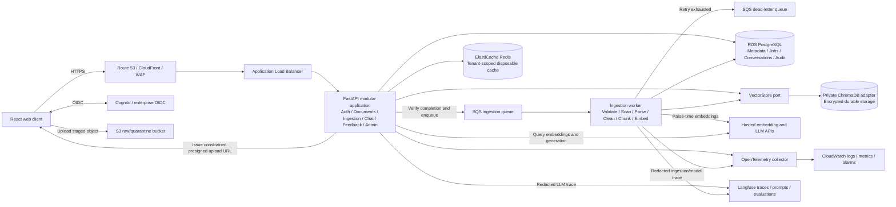

# Container View

## Container Responsibilities

| Container | Responsibility | Boundary |
|---|---|---|
| React web client | Authenticated upload, progress/status, chat, citations, feedback, and evaluation/admin screens | Public browser; never trusted for authorization |
| FastAPI modular application | Auth/tenant, documents, ingestion coordination, retrieval/chat, conversations, feedback, evaluations, health, and admin use cases | Stateless interactive service; business modules remain within one deployable application initially |
| Ingestion worker | Queue consumer for validation, malware/quarantine workflow, parsing, cleaning, chunking, enrichment, embedding, indexing, retry, and status updates | Separately scalable worker; idempotent processing required |
| PostgreSQL | Authoritative tenant-scoped document/job/conversation/feedback/audit metadata | Private subnet; access through application adapters |
| S3 | Original and, if needed, processed document objects | Private buckets, encryption, versioning/retention policy, and tenant-aware object keys |
| SQS and DLQ | Durable ingestion handoff, retry visibility, and poison-job isolation | Private AWS service access; messages carry identifiers, not document contents |
| Redis | Optional session/retrieval/embedding cache | Disposable and tenant-keyed; cache miss must not change correctness |
| ChromaDB adapter | Chroma-specific persistence/query implementation behind the vector-store port | Private and replaceable; no browser or API-layer Chroma SDK dependency |
| Hosted AI providers | Embedding and answer generation | External egress; timeouts, quotas, redaction policy, and provider failure handling required |
| Observability | OpenTelemetry-compatible instrumentation, CloudWatch operations, and Langfuse LLM/evaluation traces | Tenant/user labels must be access-controlled; prompt/document capture minimized or redacted |

## Dependency Rules

- The browser talks only to the public edge/API and identity provider. Direct S3 upload is limited to a short-lived URL for one staged object.
- API and worker use application-owned ports for PostgreSQL, object storage, queue, cache, vector store, and model provider adapters.
- ChromaDB-specific types and operations remain in the vector adapter. Retrieval use cases depend on the vector-store contract.
- Queue messages identify an upload/document version and job; they do not carry the source file or credentials.
- Redis, vector storage, telemetry, and model providers are not sources of authorization truth.

