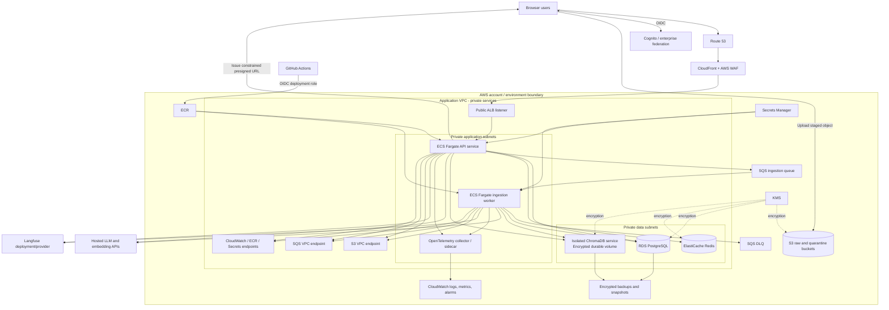

# AWS Deployment View

## Network and Runtime Placement

- Route 53 and CloudFront/WAF provide the public edge. The browser reaches the application through the ALB; application, worker, database, cache, and vector services have no public listeners.
- Cognito or enterprise federation handles identity. The API validates signed tokens and derives tenant/user/role context before accessing data.
- ECS Fargate hosts stateless API and worker services in private application subnets. Scale them independently using request/CPU/queue-depth signals.
- RDS PostgreSQL, ElastiCache Redis, and the isolated ChromaDB service live in private data subnets with security groups limiting callers to required API/worker paths.
- S3 and SQS are reached through AWS service endpoints where supported. Buckets, queues, database storage, backups, and Chroma persistent storage use encryption with KMS-managed keys and least-privilege IAM.
- ChromaDB is a stateful initial service, not an assumed production-grade managed database. Its persistence, backup/restore, horizontal scaling, and maintenance behavior are release gates. Preserve the vector-store port so migration remains possible.
- Hosted model and embedding providers require controlled outbound HTTPS egress. Apply provider timeouts/quotas and avoid sending unnecessary PII or secrets. Use private connectivity where the selected provider supports it and policy requires it.
- CloudWatch receives operational logs, metrics, dashboards, and alarms. Langfuse receives LLM trace/evaluation data subject to redaction and access controls.

## CI/CD and Operations

1. GitHub Actions runs formatting, static checks, unit/integration/contract tests, dependency and image scans, IaC validation, and RAG evaluation thresholds.
2. A GitHub OIDC trust relationship issues short-lived deployment credentials; no long-lived cloud access key is stored in repository secrets.
3. Build and scan immutable container images, push to ECR, deploy to a non-production environment, apply reviewed database migrations, run smoke/evaluation checks, then promote using a controlled rollout.
4. Failed health or evaluation gates stop promotion; deployment rollback restores the previous application image. Database migrations must use expand/contract compatibility.
5. Configure alarms for API availability/latency, provider failures, worker errors, queue age/depth, DLQ growth, database capacity, cache availability, and vector-store health.
6. Define backup retention, restore drills, RPO/RTO, regional recovery, and cost budgets before production. Numerical targets remain undecided in this phase.
