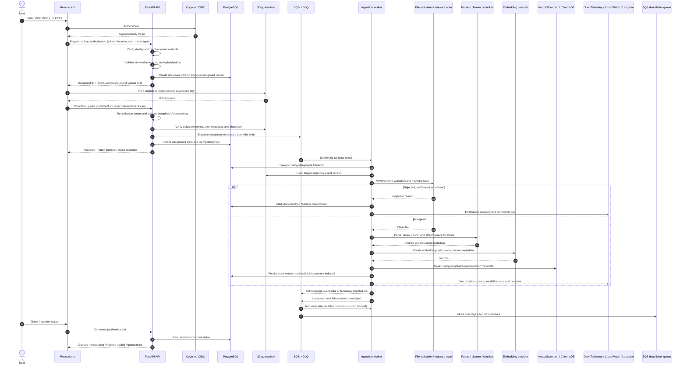

# Ingestion Sequence

## Reliability and Lifecycle Notes

- SQS delivery is at least once; the worker uses a stable tenant/document/version idempotency identity and upserts rather than blindly appending chunks.
- A job becomes visible as indexed only after vector writes and durable metadata updates are confirmed. If those operations cannot be made atomic, use a recoverable index-version state and reconciliation job.
- Retries are bounded and apply only to transient faults. Invalid, infected, unsupported, or malformed inputs are terminal and must not be retried indefinitely.
- DLQ messages contain identifiers and error categories; replay requires operator authorization and uses the same idempotency identity.
- Source object version/checksum is retained with the document version so retries and re-indexing use the same bytes.
- Deletion marks the document unavailable immediately, cancels or invalidates in-flight jobs, removes vector records and cache entries, and applies the configured S3/metadata retention policy. The exact deletion SLA is deferred.
