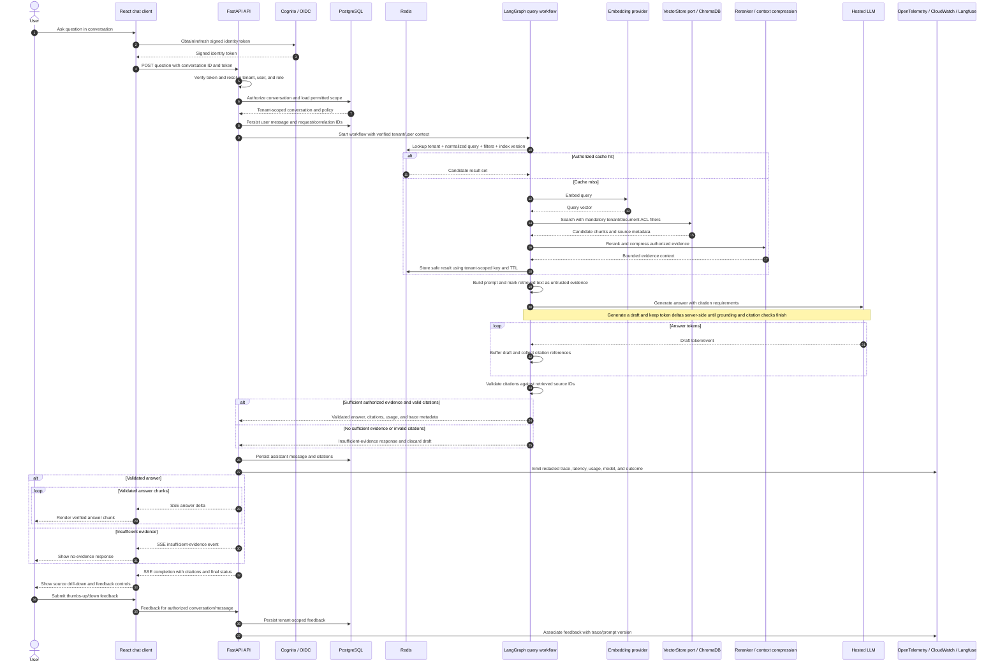

# Online Query and Cited Streaming Sequence

## Query Safety and Failure Behavior

- Verify conversation ownership and derive tenant scope before reading cache or retrieval results.
- Apply tenant and document authorization filters in the vector-store adapter; do not rely on prompt instructions or client-provided filters for access control.
- Cache keys include tenant, normalized query, authorized filters, index version, and retrieval parameters. Unsafe or permission-sensitive generated answers are not shared across users or tenants.
- Retrieved chunks are labeled as untrusted evidence. The system prompt and policy are kept separate; document text cannot authorize tools, change policy, or request secrets.
- Citations are checked against the retrieved set before finalization. If evidence is insufficient, citations are invalid, or the provider fails, return a clear bounded failure/insufficient-evidence event rather than inventing an answer.
- Draft tokens are not exposed to the browser until evidence and citation checks pass. The UI can show progress during generation; validated answer chunks are then delivered over SSE. This favors evidence safety over minimum time-to-first-answer-token.
- Cancellation, timeout, provider throttling, vector-store unavailability, and cache failure are observable outcomes. A cache or telemetry outage must not bypass authorization.
