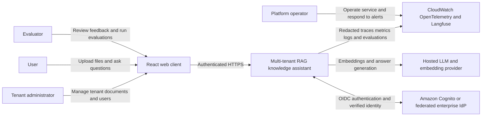

# System Context and Bounded Contexts

## Product Boundary

The RAG knowledge assistant accepts tenant-owned documents, indexes their contents, and returns answers grounded in authorized sources. The application owns authorization, document lifecycle, conversations, retrieval orchestration, citations, and feedback. Identity, AWS infrastructure, and hosted AI providers are external dependencies.

## Bounded Contexts

| Context | Responsibility | Owns / controls |
|---|---|---|
| Web/client layer | Login experience, upload, ingestion status, chat, streaming, citations, feedback, and user-facing errors | Presentation state only; no authority over tenant scope |
| Edge, identity, and security | Public ingress, TLS, WAF controls, authentication, role/tenant claims, and authorization policy | Verified principal and trusted tenant context |
| FastAPI application layer | HTTP use cases, request validation, orchestration, authorization checks, and streaming response lifecycle | Application use cases; delegates persistence and provider calls through ports |
| Asynchronous ingestion pipeline | Validate uploaded object, scan/quarantine, parse, clean, chunk, enrich metadata, embed, index, and update job status | Idempotent job execution and lifecycle transitions |
| Online RAG/query pipeline | Apply access scope, rewrite/route query as configured, retrieve, rerank/compress, build prompt, generate, validate citations, and stream | Query orchestration and evidence-grounded answer policy |
| Metadata and conversation data | Persist tenant/user associations, documents, jobs, conversations, messages, feedback, and audit metadata | Durable source of truth in PostgreSQL |
| Vector storage | Store/query embeddings with tenant and document metadata filters | Vector-store adapter; ChromaDB implementation is replaceable |
| Cache layer | Cache safe, tenant-scoped session, embedding, or retrieval results with explicit invalidation | Disposable derived data; never authorization or durable truth |
| Observability and evaluation | Correlate requests/jobs, measure latency/errors/cost, capture LLM traces/feedback, and run offline/online evaluations | Redacted telemetry and evaluation outcomes |
| CI/CD and AWS runtime | Build, scan, deploy, migrate, smoke-test, roll back, and operate services and dependencies | Runtime infrastructure, secrets, alarms, backup, and deployment controls |

## Trust and Ownership Rules

- The API validates the identity token and resolves tenant membership before invoking a use case. A tenant ID supplied by the browser is only a requested resource scope and must be checked against the verified principal.
- Every document, job, conversation, chunk, vector query, and cache key is scoped to the authorized tenant. A cache hit is re-authorized before use.
- Uploaded and retrieved text is untrusted data. It can provide evidence but cannot change system policy, permissions, or tool execution rules.
- PostgreSQL is authoritative for metadata and lifecycle. S3 is authoritative for original bytes. Vector and cache contents are derived and must be rebuildable or invalidatable.
- The browser receives short-lived upload authorization for a single staged object; it does not receive AWS credentials or access to private data services.

## Primary Flows

- [Ingestion sequence](ingestion-sequence.md): upload, verification, queueing, processing, and indexing.
- [Online query sequence](online-query-sequence.md): authorization, retrieval, grounded generation, and streaming citations.
- [Containers](containers.md): runtime responsibilities and dependencies.
- [Deployment](deployment.md): AWS topology and network exposure.
- [Threat model](threat-model.md): assets, attack paths, controls, and residual risk.

