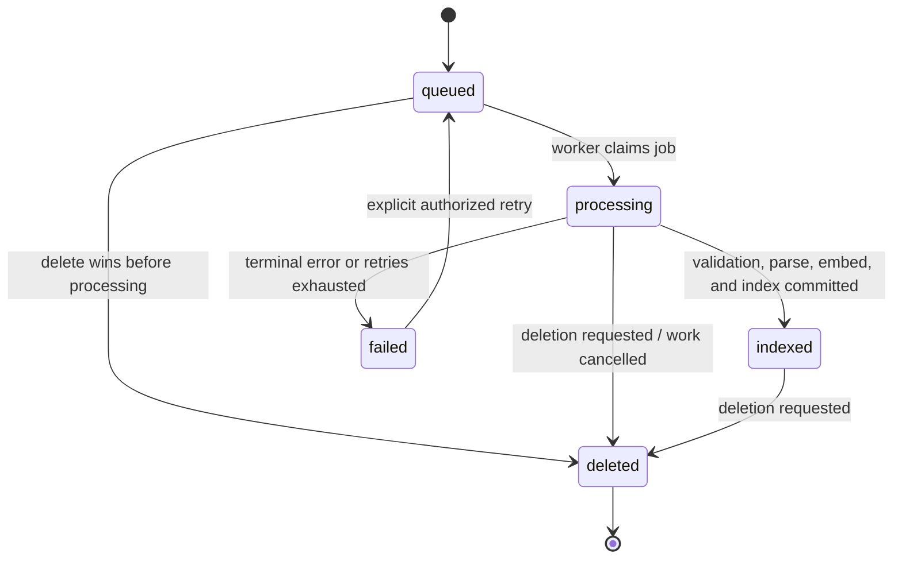

# Domain and Data Model Contracts

The entity model describes durable domain concepts, not ORM tables. IDs are opaque UUIDs. All timestamps are UTC RFC 3339. Tenant identity is an authorization boundary and is not accepted as a client-controlled field on tenant-facing requests.

## Entities and Invariants

| Entity | Important fields | Relationships / invariants |
|---|---|---|
| Tenant | `tenant_id`, name, state, created_at | Parent security scope for tenant users and tenant-owned resources |
| Membership | `tenant_id`, `user_id`, role, state | Unique active membership per tenant/user; role is checked on every operation |
| Document | `document_id`, `tenant_id`, owner_user_id, file_name, media_type, current_version_id, status, timestamps | Belongs to one tenant; contains immutable versions; all reads/deletes check tenant and resource policy |
| DocumentVersion | `version_id`, `document_id`, version_number, checksum, size, media_type, object_key/version, status, parser/index config versions | Immutable source identity; indexed chunks always refer to one version; deleted version is terminal |
| Chunk | `chunk_id`, tenant_id, document_id, version_id, ordinal, content_hash, text, page/slide/section location, metadata | Derived from one version; not independently shareable; retrieval metadata must preserve tenant/document scope |
| EmbeddingReference | `chunk_id`, model_version, index_version, vector_ref, created_at | Refers to a chunk and a versioned embedding/index configuration; vendor vector ID is infrastructure-only |
| IngestionJob | `job_id`, tenant_id, document_id, version_id, idempotency_key, status, attempt, failure_code, timestamps | One logical job per idempotency identity; execution attempts do not create duplicate logical versions |
| Conversation | `conversation_id`, tenant_id, owner_user_id, title, created_at, updated_at | Owned by one tenant/user; every message read and write verifies conversation access |
| Message | `message_id`, conversation_id, role, content, status, created_at, trace/correlation IDs | Ordered within conversation; assistant completion status distinguishes completed, insufficient evidence, and failed |
| Citation | `message_id`, chunk_id, document_id, version_id, source location, excerpt | Must reference a chunk retrieved for that request and still authorized at response time |
| Feedback | `feedback_id`, tenant_id, user_id, message_id, rating, note, created_at | One user's latest feedback per completed assistant message; note length bounded and content treated as user input |
| EvaluationRun | `run_id`, tenant_id/scope, requester, dataset_id/version, prompt/retrieval/model versions, status, metrics, timestamps | Dataset and configuration access are authorized; aggregate output is tied to exact versions |

## Ingestion Job State Machine

### State Rules

- `queued`: verified upload is associated with a durable job; not searchable.
- `processing`: one idempotent worker claim is active; a visibility-timeout redelivery may claim after lease expiry.
- `indexed`: all chunks for the version are available through the authorized vector-store port and index metadata is committed.
- `failed`: processing is terminal for the current attempt sequence. An explicit authorized retry creates a new attempt on the same immutable version and retains an audit trail.
- `deleted`: access is revoked and the version is never re-indexed. Physical object/vector/cache cleanup may remain pending, but cleanup state is an internal deletion operation, not a way to restore visibility.
- Duplicate messages for `indexed` or `deleted` jobs are acknowledged without repeating visible side effects.
- A new upload creates a new document version and job; it does not mutate indexed chunks in place.

## RAG Workflow State

The serialized Pydantic `RagWorkflowState` in `packages\contracts\python\rag_contracts\models.py` includes:

- `question`, `tenant_id`, `user_id`, `conversation_id`, `message_id`
- `rewritten_queries`
- `retrieved_documents` with chunk/document/version IDs, evidence, score, and source location
- `reranked_context`
- `answer` and verified `citations`
- `safety_flags`
- `token_usage` and `cost_usd`

This state is a schema, not a decision to persist full document text in checkpoints. Any workflow checkpointing must apply tenant access control, data minimization, retention, and deletion policy. A graph framework's own state types are kept in an adapter.

## Model Ownership

`packages\contracts\python\rag_contracts\models.py` contains boundary DTOs and serializable workflow schemas only. Domain aggregates and ports in `packages\domain\` must not import these Pydantic models; adapters map between transport, domain, and persistence representations.

